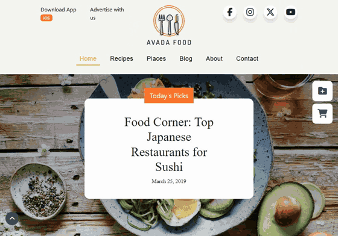

# Foodie Journal

**Prova la demo:** https://francesco-mauro.github.io/proj-html-vuejs/



La replica di un sito di cucina in Vue.js, a partire dal tema Avada Food. Progetto di gruppo del Master Full Stack di Boolean, costruito in quattro giorni a maggio 2024.

## Cosa contiene

- **Home:** hero con sovrapposizione colorata, ricette popolari, raccolte, sezione "farm to table", iscrizione alla newsletter.
- **Chi siamo:** i valori del sito, gli autori e la sezione "We Are Hiring".
- **Contatti:** pagina con i recapiti e il modulo.
- **Navigazione** con Vue Router, pulsante per tornare in cima e pulsanti laterali fissi.
- **Ricette, Blog e Luoghi:** alla consegna erano pagine segnaposto, nel 2026 hanno avuto una pagina con le card.

## La mia parte

Eravamo in tre, con [wmancaniello](https://github.com/wmancaniello) e [SimoneMicheleAllocca](https://github.com/SimoneMicheleAllocca). Io ho curato:

- **l'header**, con i link alle pagine, lo stato attivo della pagina corrente e gli effetti sulle icone;
- **il componente delle icone social**;
- **la pagina Chi siamo**, dalla struttura alla validazione dell'HTML e del CSS;
- **gli effetti di hover** sulle card e sui traguardi della home.

## Correzioni del 2026

Ripreso a novembre 2026 per pubblicarlo online.

- **Nella mia parte:** sul telefono l'intestazione va in colonna e il menu va a capo (prima usciva dallo schermo da tutti e due i lati), «Contact Us» porta ai contatti, il logo usa il router, le icone social hanno un nome per gli screen reader, i titoli sono in ordine, le immagini hanno testi alternativi veri e i caratteri della pagina vengono caricati davvero. Tolti la lente di ricerca e i puntini dei testimonial, che sembravano cliccabili e non facevano niente.
- **Nel resto del sito:** le immagini delle card in home ora si vedono anche dopo la build, la pagina non scorre più di lato (sul telefono la home sconfinava di 351 pixel) e i due pulsanti fissi a destra non coprono più il menu sul telefono. Le foto sono state alleggerite (da 13,4 MB a 2,7 MB in totale), le immagini prima prese dal sito di Avada ora stanno nel repository e il link condiviso mostra un'anteprima.
- **Accessibilità e velocità:** colori più scuri dove il testo si leggeva poco, nomi per link e pulsanti fatti di sola icona, titoli in ordine, immagini non più deformate, foto ridotte alla misura in cui sono mostrate, un'immagine dell'hero più leggera per il telefono e solo le icone usate di Font Awesome.
- **Pubblicazione:** GitHub Pages, costruito da GitHub Actions a ogni push.

## Lighthouse

Misurato sulla demo online il 13 novembre 2026, con Lighthouse 12. Prima delle correzioni del 2026: telefono 76, 78, 96, 100.

| | Prestazioni | Accessibilità | Buone pratiche | SEO |
|---|---|---|---|---|
| Telefono | 93 | 100 | 100 | 100 |
| Computer | 99 | 100 | 100 | 100 |

## Strumenti

Vue 3, Vue Router, Vite, Bootstrap 5, Sass, Font Awesome, Git in team.

Claude Code, come assistente per le correzioni del 2026 e per questo README.

## Come provarlo

```bash
git clone https://github.com/francesco-mauro/proj-html-vuejs.git
cd proj-html-vuejs
npm install
npm run dev
```

Poi apri l'indirizzo che compare nel terminale, di solito http://localhost:5173.
